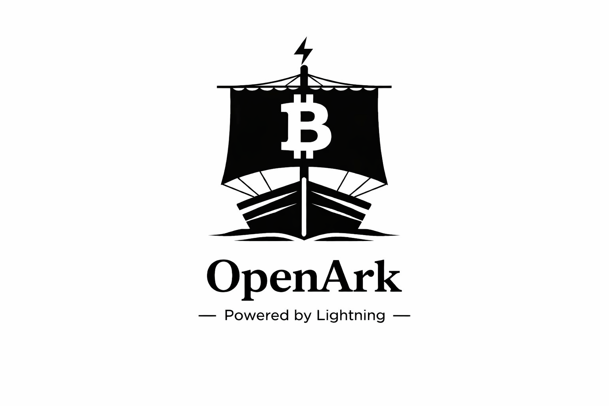
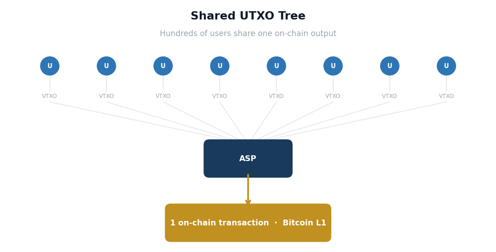
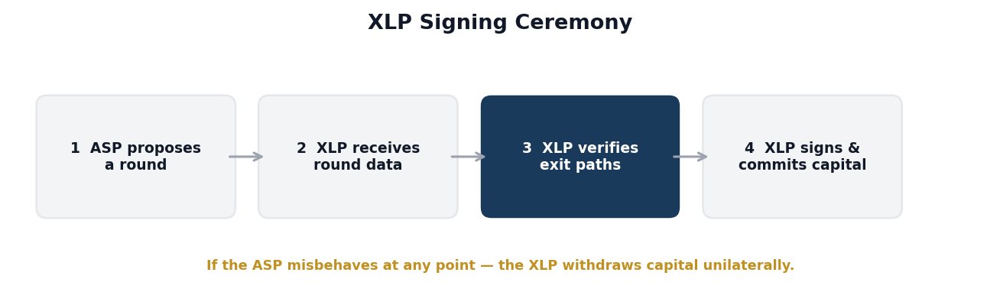
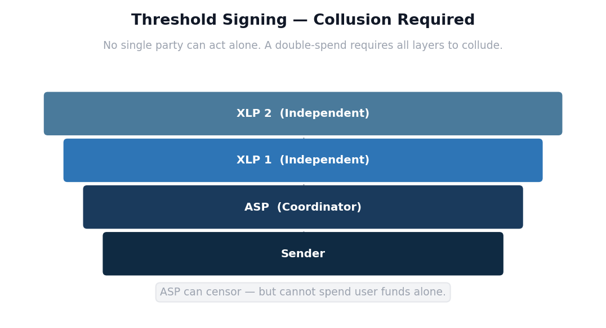
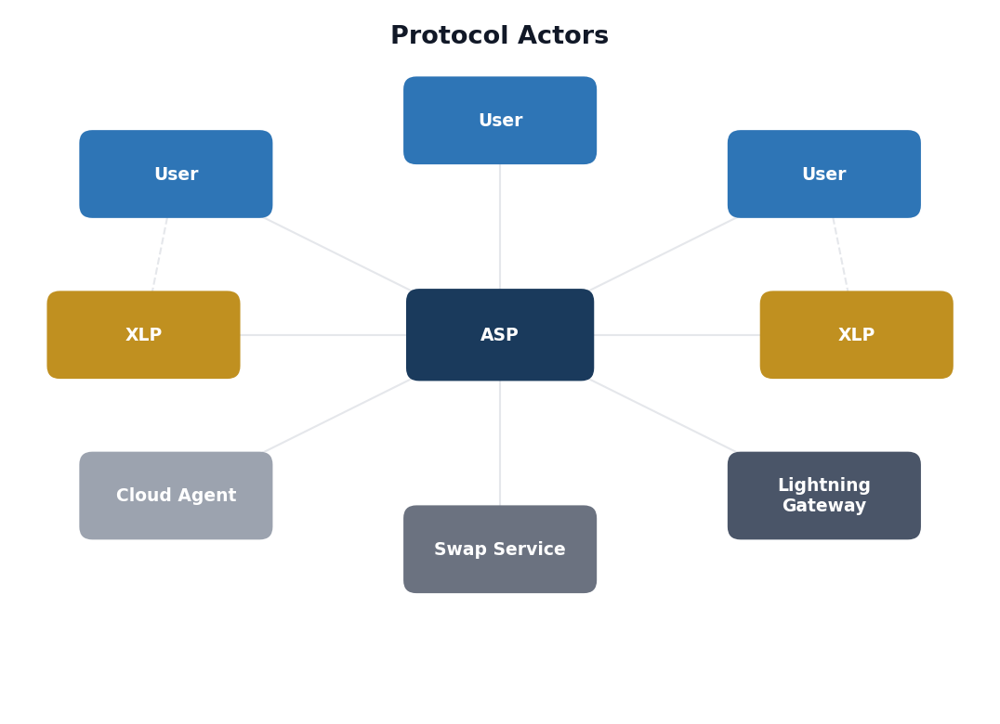
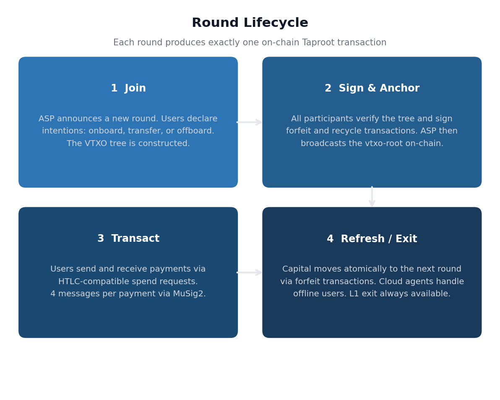
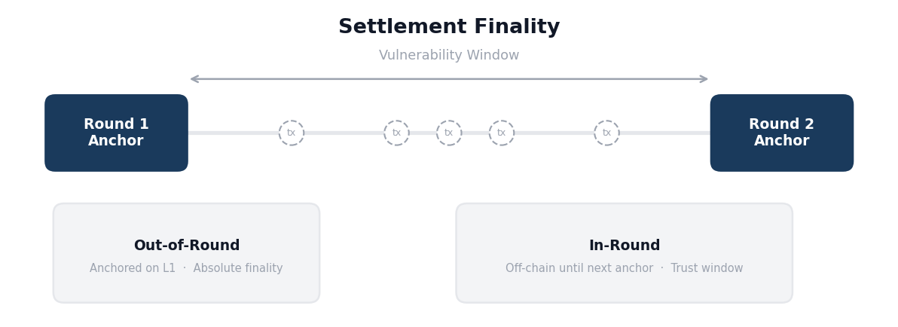

# OpenSats Grant Application — OpenArk Protocol

| Field         | Details                              |
| ------------- | ------------------------------------ |
| Main Focus    | Layer 2 / Lightning Network          |
| Project Name  | OpenArk Protocol                     |
| Specification | BOLT-ARK — github.com/dukeh3/openark |
| Website       | openark.tech                         |
| License       | GPL3 / Open Source                   |

---

## Table of Contents

1. [Project Description](#project-description)
2. [Background: What is Ark?](#background-what-is-ark)
3. [The Problem: Structural and Incentive Failures in Existing Ark](#the-problem-structural-and-incentive-failures-in-existing-ark)
4. [The Deeper Problem: Incentive Misalignment](#the-deeper-problem-incentive-misalignment)
5. [The Solution: OpenArk](#the-solution-openark)
6. [Protocol Actors](#protocol-actors)
7. [How a Round Works](#how-a-round-works)
8. [Settlement Finality](#settlement-finality)
9. [Lightning Network Compatibility](#lightning-network-compatibility)
10. [Design Decisions](#design-decisions)
11. [Potential Impact](#potential-impact)
12. [Success Metrics (12-month targets)](#success-metrics-12-month-targets)
13. [Project Timeline](#project-timeline)
14. [Budget](#budget)
15. [Applicant Details](#applicant-details)

---

## Project Description

### Background: What is Ark?

Ark is a Bitcoin Layer 2 protocol that allows hundreds of users to share a single on-chain UTXO via a structure called a VTXO tree. Rather than requiring each user to lock capital bilaterally as in the Lightning Network, Ark batches participants into shared rounds. Each user holds a VTXO, an off-chain representation of a Bitcoin UTXO with a valid on-chain spending path, guaranteeing unilateral exit to L1 is always available.

An Ark Service Provider (ASP) coordinates rounds: constructing the VTXO tree, broadcasting the vtxo-root as a single Taproot output, and cosigning transfers. Each round, regardless of whether it contains 10 or 10,000 participants, produces exactly one on-chain transaction.

*Hundreds of user VTXOs aggregated into a single on-chain Taproot transaction. Each round produces exactly ONE on-chain Taproot transaction, regardless of whether there are 10 or 10,000 participants.*

### The Problem: Structural and Incentive Failures in Existing Ark

Existing Ark implementations rely on a single-operator model: one ASP holds one signing key and funds every round with its own capital. This creates three structural failures:

| Failure               | Description                                                                                                                   |
| --------------------- | ----------------------------------------------------------------------------------------------------------------------------- |
| Single-Operator Trust | All operation depends on one party. If the ASP censors or goes offline, users are forced into slow, costly unilateral exits.  |
| Locked-in Liquidity   | External capital providers cannot verify exit paths before committing. Participation requires unconditional trust in the ASP. |
| Fee Extraction        | Centralized ASPs capture all fees and dictate terms. Wallet providers become mere clients rather than sovereign peers.        |

### The Deeper Problem: Incentive Misalignment

Today's Ark implementations are proprietary, built in isolation, and based on no shared standard. There is no interoperability and no neutral specification for independent developers to build against.

This is a structural outcome of the single-operator funding model. When the ASP is also the capital provider — borrowing BTC onto its own balance sheet to earn yield — the operator has no incentive to open the protocol to external liquidity. Proprietary implementations protect this arrangement.

The result is a fundamental misalignment with wallet providers. When single-operator ASPs approach wallet providers for integration, wallet providers routinely decline. They don't want dependency on a third-party ASP whose operation, fees, and censorship policies they can't control. The model that makes single-operator Ark investable makes it unattractive to the wallet providers it needs to reach.

OpenARK is not a competing proprietary implementation. It is a community-driven protocol specification and reference implementation covering the core roles — ASP, user, liquidity provider — built on an open standard anyone can adopt. Any wallet provider can run its own ASP, sourcing capital from open XLP markets rather than a single investor-backed operator. Wallet providers don't trade sovereignty for access.

This design is unlikely to emerge from inside commercial implementations, because introducing trustless external liquidity providers would disintermediate the single-operator revenue model. OpenARK exists to fill that gap.

---

### The Solution: OpenArk

OpenArk is **BOLT-ARK** — an open protocol specification that brings Ark into the Lightning ecosystem as a formal BOLT extension. It is not a proprietary implementation, not a commercial product, and not an ASP service. It is a community-driven standard with a reference implementation (`openark-rs`) that anyone can build against.

BOLT-ARK addresses all three failures of existing Ark — single-operator trust, locked-in liquidity, and fee extraction — through five integrated design choices.

#### 1. An Open Specification, Not a Proprietary SDK

BOLT-ARK is published under GPL-3 as a peer-reviewed protocol specification. Like the Lightning BOLTs before it, it exists to enable a multi-implementer ecosystem. Any developer, wallet provider, or company can build a conforming implementation without vendor dependency, licensing restrictions, or permission.

This is a deliberate departure from existing Ark implementations, which are developed in isolation with no shared standard and no path to interoperability.

#### 2. Wallet Providers Become ASPs

OpenArk does not aim to operate an ASP. It encourages **wallet providers to become ASPs themselves**. The protocol is designed so that any wallet provider can coordinate rounds, set fee structures, and capture transaction fees directly — without depending on a third-party service provider.

This is why existing single-operator ASPs struggle with wallet provider adoption: wallet providers don't want dependency on a third party whose operation, fees, and censorship policies they can't control. OpenArk removes this barrier entirely. The wallet provider *is* the operator.

#### 3. Trustless External Liquidity Providers (XLPs)

XLPs are what make wallet provider-operated ASPs economically viable. They supply on-chain capital to fund rounds without needing to trust the ASP.

Before signing anything, an XLP cryptographically verifies that valid exit paths exist in every execution branch of the proposed round. Only upon successful verification does it commit capital and co-sign.

This is enforced through multi-party signing. The spending key for the VTXO tree is a joint key constructed across the ASP and all XLP co-verifiers using MuSig2. Every party must sign. No subset is sufficient. An attacker must compromise the ASP **and** every XLP simultaneously — a fundamentally different threat model from single-operator Ark.

If the ASP misbehaves, the XLP simply withdraws capital unilaterally. Total capital protection without trusting the coordinator.

> **Deployment note:** Because XLPs participate in every round's MuSig2 signing ceremony in real time, network latency between the XLP and ASP directly affects round completion time. XLPs should ideally be geographically co-located with the ASP to keep signing latency low and round throughput high.

#### 4. Transparent Coordination via Nostr (NIP-150)

All protocol coordination happens over ASP-operated Nostr relays using a standardized transport layer (NIP-150). No proprietary APIs. No black boxes.

Because Nostr messages are publicly inspectable, anyone — clients, XLPs, independent watchdogs — can audit ASP behavior by inspecting relay traffic. Transparency is not a policy promise; it is a structural property of the communication layer.

#### 5. An Ecosystem of Thousands of Competing ASPs

OpenArk envisions a network of thousands of independent ASPs competing on service quality, fees, and reliability. Success is not measured by becoming the dominant ASP — it is measured by becoming the most widely adopted protocol implementation.

This is the same model that made Lightning successful: not one company, but an open standard that enabled dozens of independent implementations and a decentralized network of operators. OpenArk aims to do for Ark what the BOLT specifications did for Lightning.

*XLP signing ceremony: verification before commitment, unilateral withdrawal if ASP misbehaves.*

*Multi-party signing stack: all layers must collude to execute a double-spend.*

---

## Protocol Actors

*OpenArk protocol actors and their relationships.*

| Actor             | Role                                                                                                                                                                                                                                                                                                                                                                                                          |
| ----------------- | ------------------------------------------------------------------------------------------------------------------------------------------------------------------------------------------------------------------------------------------------------------------------------------------------------------------------------------------------------------------------------------------------------------- |
| User              | Holds VTXOs. Uses a cold owner key for spending authority and a hot agent key for round participation. Owner key stays offline.                                                                                                                                                                                                                                                                               |
| ASP               | Coordinates rounds, constructs VTXO trees, broadcasts vtxo-root. Can censor but cannot unilaterally spend user funds.                                                                                                                                                                                                                                                                                         |
| XLP               | External Liquidity Provider. Supplies capital, co-verifies the threshold key, confirms exit paths per round, earns proportional fees.                                                                                                                                                                                                                                                                         |
| Cloud Agent       | Delegated process that participates in round transitions on behalf of offline users. Holds a hot agent (time-locked) key that authorizes end-of-round operations but has no spending authority over the user's funds after round transition. The agent key is rotated every round, limiting exposure if compromised. The user's cold owner key — which controls actual spending — stays in the user's device. |
| Lightning Gateway | Bridges OpenArk to the Lightning Network. Runs standard Lightning node software.                                                                                                                                                                                                                                                                                                                              |
| Swap Service      | Handles on-chain ↔ VTXO conversions for onboarding and offboarding.                                                                                                                                                                                                                                                                                                                                           |

---

## How a Round Works

Each OpenArk round proceeds in four phases and produces a single on-chain Taproot transaction.

*The four-phase round lifecycle, producing one on-chain transaction per round.*

---

## Settlement Finality

*Settlement finality: out-of-round payments are L1-final; in-round payments have a vulnerability window.*

| Payment Type          | Finality Guarantee                                                                                                                                                                                                                                                                                                                                        |
| --------------------- | --------------------------------------------------------------------------------------------------------------------------------------------------------------------------------------------------------------------------------------------------------------------------------------------------------------------------------------------------------- |
| Out-of-round payments | Absolute — anchored on-chain with the vtxo-root. Backed by Bitcoin L1 the moment the block confirms.                                                                                                                                                                                                                                                      |
| In-round payments     | Conditional — rely on the signing group's honesty until the next round anchors a new state. The vulnerability window spans from payment receipt to next round confirmation, typically seconds to minutes depending on round frequency. Mitigation: recipients processing high-value in-round payments can defer settlement until the next round confirms. |

---

## Lightning Network Compatibility

OpenArk is an extension of Lightning, not a replacement. The protocol preserves complete HTLC semantics — the same hashlocks, timelocks, and preimage reveals that Lightning uses. Existing Lightning nodes require no modifications.

ARK Services — XLPs and Lightning Gateways — can run standard Lightning nodes, directly adding routing capacity to the broader network. Every new XLP that joins the OpenArk ecosystem also contributes routing liquidity to Lightning.

---

## Design Decisions

| Decision                      | Rationale                                                                                                                                      |
| ----------------------------- | ---------------------------------------------------------------------------------------------------------------------------------------------- |
| No soft fork required         | Works on Bitcoin today via pre-signed transactions with MuSig2. Future covenant opcodes (CTV, CSFS) will optimize but are not dependencies.    |
| Nostr transport (NIP-150)     | Standardized, auditable coordination via ASP-operated relays. No proprietary APIs. Clients can audit ASP behavior by inspecting relay traffic. |
| Cloud agent model             | Separates cold spending authority (owner key) from hot operational participation (agent key). Users stay offline safely.                       |
| Open specification (BOLT-ARK) | Community-driven protocol spec, not a commercial SDK. No vendor lock-in. No company, no token, no permission required.                         |

---

## Potential Impact

### Immediate Impact

- **First open Ark specification.** BOLT-ARK will be the first GPL-3 licensed, peer-reviewed protocol specification for Ark. Any developer can build against it without vendor dependency or proprietary SDK requirements.
- **Trustless liquidity provision on Bitcoin.** The XLP model enables capital providers to fund Ark rounds with cryptographic verification of exit paths — no counterparty trust required. This opens Ark to a competitive liquidity market rather than single-operator capital provision.
- **Materially improved security posture.** Multi-party signing means a single key compromise is not catastrophic. An attacker must compromise the ASP and every XLP simultaneously.

### Longer-Term Impact

- **Wallet provider-native ASP deployment.** Wallet providers and LSPs can run their own ASPs sourcing capital from open XLP markets. This removes the integration barrier that has stalled Ark adoption among sovereignty-conscious wallet provider teams.
- **Lightning Network capacity growth.** Every Lightning Gateway deployed in the OpenARK ecosystem adds routing capacity to the broader Lightning Network. OpenARK feeds liquidity into Lightning rather than competing with it.
- **Multi-implementer ecosystem.** The open SDK, CLI tooling, and full documentation of the VTXO lifecycle, signing ceremonies, and transport layer are designed to seed the same kind of independent-implementer ecosystem that has driven Lightning's growth.

---

## Success Metrics (12-month targets)

- BOLT-ARK v1.0 specification frozen and published
- At least one independent ASP deployment not operated by the core team
- At least one wallet integration (Alby Hub pilot is the current lead candidate)
- Completed independent security audit with findings published
- Public testnet with documented XLP onboarding process

---

## Project Timeline

12 months, covering public testnet through mainnet beta and initial protocol hardening.

| Q2 2026 — Public Testnet                         | Q3 2026 — Mainnet Beta                              | Q4 2026 — Protocol Hardening       |
| ------------------------------------------------ | --------------------------------------------------- | ---------------------------------- |
| Testnet ASP deployment                           | Live mainnet ASP launch                             | Independent security audits        |
| Open-source SDK and CLI release (LDK based)      | Lightning Gateway integration                       | Network stress testing             |
| Developer documentation (full VTXO lifecycle)    | Reference wallet (owner key / agent key separation) | ASP operator toolkit               |
| NIP-150 Nostr transport reference implementation | Initial XLP onboarding                              | Third-party wallet integrations    |
| XLP signing ceremony tooling                     | Cloud agent reference implementation                | BOLT-ARK v1.0 specification freeze |

---

## Budget

| Item                                             | Amount       |
| ------------------------------------------------ | ------------ |
| Project Lead Compensation                        | $100,000     |
| Security Audits and Additional Technical Reviews | $50,000      |
| **Total**                                        | **$150,000** |

| Activity         | Scope                                                                                                                     |
| ---------------- | ------------------------------------------------------------------------------------------------------------------------- |
| Core Development | Full-time. BOLT-ARK specification, MuSig2 signing ceremony, forfeit/recycle transaction logic, XLP verification protocol. |
| Infrastructure   | Full-time. ASP reference implementation, Nostr relay integration, SDK and CLI tooling, testnet and mainnet deployment.    |
| Security Audit   | Dedicated budget for independent audit of signing ceremony, XLP verification, and unilateral exit paths. (Q3 2026)        |

---

## Applicant Details

### Project Lead

| Field         | Details                                                                  |
| ------------- | ------------------------------------------------------------------------ |
| Name          | Rene Malmgren                                                            |
| Email         | rene@gmail.com                                                           |
| GitHub        | https://github.com/OpenARK-Organisation                                  |
| Specification | https://github.com/OpenARK-Organisation/openark/blob/main/15-open-ark.md |

### References

#### Prior Contributions

- OpenArk BOLT-ARK specification — initial draft and ongoing revisions (github.com/dukeh3/openark)
- OpenArk educational materials and landing page (openark.tech)
- KeyMaster (Open source key generator for SSH, GPG and Nostr)

