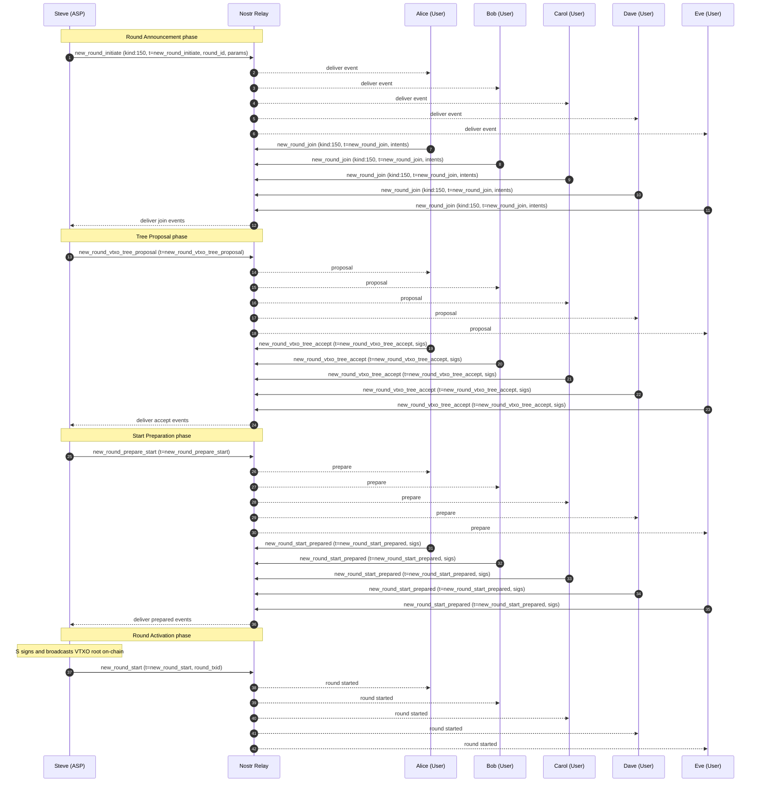

# Example 1.0

## Alice, Bob, Carol, Dave, and Eve Create a VTXO Tree

In this part of the example, the users join a new ARK round run by Steve.

### Scope & References

- Protocol semantics and canonical roles: [15-open-ark.md](../15-open-ark.md)
- Message definitions and event format: [nip-150.md](../nip-150.md)
- Nostr transport model in this example: single relay multicast (`kind:150`, `tags` include `["t","<message_type>"]`)

### Actors in this scenario

- Alice (User)
- Bob (User, service-role in this scenario)
- Carol (User)
- Dave (User)
- Eve (User, service-role in this scenario)
- Steve (ASP)

### Step 1 -- [`new_round_initiate`](../nip-150.md#new_round_initiate) (Phase: Round Announcement)

- **Publisher:** Steve (ASP)
- **Transport:** Nostr event `kind:150`, tag `["t","new_round_initiate"]`
- **Audience (scenario):** Alice, Bob, Carol, Dave, Eve (via relay multicast)
- **Preconditions (scenario):** Previous round is ready for participant announcement.
- **Scenario payload values:** `round_id`, timing parameters (including close/end blocks)
- **Expected outcome:** Users learn that a new round is open and can submit intentions.
- **Failure/timeout branch:** Users that do not receive this event in time cannot join this round.
- **Spec refs:** [15-open-ark.md §7.1.1](../15-open-ark.md#711-initiated-state), [nip-150.md `new_round_initiate`](../nip-150.md#new_round_initiate)

### Step 2 -- [`new_round_join`](../nip-150.md#new_round_join) (Phase: Round Announcement)

- **Publisher:** Alice, Bob, Carol, Dave, Eve (each as User)
- **Transport:** Nostr event `kind:150`, tag `["t","new_round_join"]`
- **Audience (scenario):** Steve (ASP)
- **Preconditions (scenario):** `new_round_initiate` received and validated for the current `round_id`.
- **Scenario payload values:** onboard/offboard/transition intentions and user keys
- **Expected outcome:** Steve has participant intentions and can construct the candidate tree.
- **Failure/timeout branch:** Missing user response at timeout means that user is excluded or handled via recycle/offboard policy.
- **Spec refs:** [15-open-ark.md §7.1.1](../15-open-ark.md#711-initiated-state), [nip-150.md `new_round_join`](../nip-150.md#new_round_join)

### Step 3 -- [`new_round_vtxo_tree_proposal`](../nip-150.md#new_round_vtxo_tree_proposal) (Phase: Tree Proposal)

- **Publisher:** Steve (ASP)
- **Transport:** Nostr event `kind:150`, tag `["t","new_round_vtxo_tree_proposal"]`
- **Audience (scenario):** Alice, Bob, Carol, Dave, Eve
- **Preconditions (scenario):** Join collection complete for this round.
- **Scenario payload values:** vtxo tree, forfeit tree, recycle transaction set
- **Expected outcome:** Users can verify exact transactions to be signed.
- **Failure/timeout branch:** Invalid proposal must be rejected by users and not signed.
- **Spec refs:** [15-open-ark.md §7.1.1](../15-open-ark.md#711-initiated-state), [nip-150.md `new_round_vtxo_tree_proposal`](../nip-150.md#new_round_vtxo_tree_proposal)

### Step 4 -- [`new_round_vtxo_tree_accept`](../nip-150.md#new_round_vtxo_tree_accept) (Phase: Tree Proposal)

- **Publisher:** Alice, Bob, Carol, Dave, Eve
- **Transport:** Nostr event `kind:150`, tag `["t","new_round_vtxo_tree_accept"]`
- **Audience (scenario):** Steve (ASP)
- **Preconditions (scenario):** Each user has validated proposal contents for expected funds and constraints.
- **Scenario payload values:** signatures for proposed VTXO tree elements
- **Expected outcome:** ASP collects required user signatures to advance to start preparation.
- **Failure/timeout branch:** Missing or invalid signatures block progression for that participant set.
- **Spec refs:** [15-open-ark.md §7.1.1](../15-open-ark.md#711-initiated-state), [nip-150.md `new_round_vtxo_tree_accept`](../nip-150.md#new_round_vtxo_tree_accept)

### Step 5 -- [`new_round_prepare_start`](../nip-150.md#new_round_prepare_start) (Phase: Start Preparation)

- **Publisher:** Steve (ASP)
- **Transport:** Nostr event `kind:150`, tag `["t","new_round_prepare_start"]`
- **Audience (scenario):** Alice, Bob, Carol, Dave, Eve
- **Preconditions (scenario):** Tree proposal accepted by participating users.
- **Scenario payload values:** requests for funding/forfeit/recycle signature finalization tied to the round root
- **Expected outcome:** Users can provide final signatures needed before activation.
- **Failure/timeout branch:** If users do not receive or accept this event, round start cannot complete collaboratively.
- **Spec refs:** [15-open-ark.md §7.1.1](../15-open-ark.md#711-initiated-state), [nip-150.md `new_round_prepare_start`](../nip-150.md#new_round_prepare_start)

### Step 6 -- [`new_round_start_prepared`](../nip-150.md#new_round_start_prepared) (Phase: Start Preparation)

- **Publisher:** Alice, Bob, Carol, Dave, Eve
- **Transport:** Nostr event `kind:150`, tag `["t","new_round_start_prepared"]`
- **Audience (scenario):** Steve (ASP)
- **Preconditions (scenario):** Users have validated final pre-start data.
- **Scenario payload values:** funding/forfeit/recycle preparation signatures
- **Expected outcome:** ASP has all required preparation signatures.
- **Failure/timeout branch:** Missing signatures prevent activation for this participant set.
- **Spec refs:** [15-open-ark.md §7.1.1](../15-open-ark.md#711-initiated-state), [nip-150.md `new_round_start_prepared`](../nip-150.md#new_round_start_prepared)

### Step 7 -- [`new_round_start`](../nip-150.md#new_round_start) (Phase: Round Activation)

- **Publisher:** Steve (ASP)
- **Transport:** Nostr event `kind:150`, tag `["t","new_round_start"]`
- **Audience (scenario):** Alice, Bob, Carol, Dave, Eve
- **Preconditions (scenario):** VTXO root signed and broadcast on-chain by ASP.
- **Scenario payload values:** `round_txid`
- **Expected outcome:** Round is officially active for off-chain operations.
- **Failure/timeout branch:** If activation is not announced or not anchored as expected, participants should treat the round as not started.
- **Spec refs:** [15-open-ark.md §7.1.1](../15-open-ark.md#711-initiated-state), [15-open-ark.md §7.1.2](../15-open-ark.md#712-started-state), [nip-150.md `new_round_start`](../nip-150.md#new_round_start)
