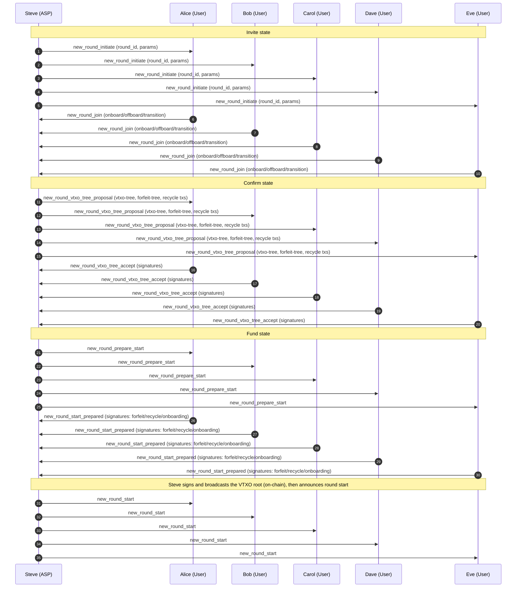

# Example 1.0

## Alice, Bob, Carol, Dave, and Eve Create a VTXO Tree

In this part of the example, the users join a new ARK round run by Steve.

### Actors in this scenario

- Alice (User)
- Bob (User, service-role in this scenario)
- Carol (User)
- Dave (User)
- Eve (User, service-role in this scenario)
- Steve (ASP)

1. Steve issues `new_round_initiate`.
- This informs everyone that a new round is starting.

2. Alice, Bob, Carol, Dave, and Eve reply with `new_round_join`.
- Here, users declare what to onboard, offboard, and transition.

3. Steve issues `new_round_vtxo_tree_proposal`.
- Steve sends the VTXO tree, forfeit tree, and recycle transactions for review and signing.

4. Alice, Bob, Carol, Dave, and Eve issue `new_round_vtxo_tree_accept`.
- Users return signatures for the proposed tree elements.

5. Steve issues `new_round_prepare_start`.
- Steve sends the VTXO root and related data that must be signed before round start.

6. Alice, Bob, Carol, Dave, and Eve issue `new_round_start_prepared`.
- Users return the required preparation signatures (forfeit/recycle/onboarding) tied to the proposed root.

7. Steve issues `new_round_start`.
- The root transaction is deposited on-chain and the round officially starts.
