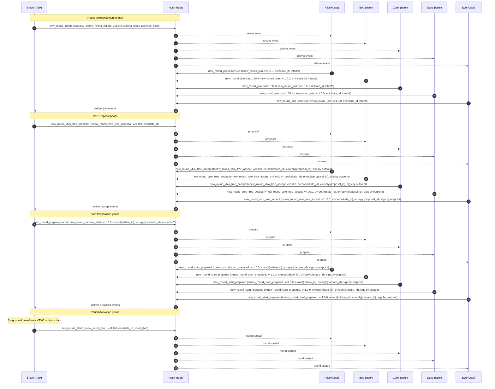

# Example 1.0

## Alice, Bob, Carol, Dave, and Eve Create a VTXO Tree

In this part of the example, the users join a new ARK round run by Steve.

### Scope & References

- Protocol semantics and canonical roles: [15-open-ark.md](../15-open-ark.md)
- Message definitions and event format: [nip-150.md](../nip-150.md)
- Nostr transport model in this example: single relay multicast (`kind:150`, `tags` include `["t","<message_type>"]`, `["v","1.0.0"]`; follow-up round messages include `e=<new_round_initiate_event_id>`)
- This example is illustrative, not a normative protocol definition.

### Actors in this scenario

- Alice (User)
- Bob (User, service-role in this scenario)
- Carol (User)
- Dave (User)
- Eve (User, service-role in this scenario)
- Steve (ASP)

### Step 1 -- [`new_round_initiate`](../nip-150.md#new_round_initiate) (Phase: Round Announcement)

- **Publisher:** Steve (ASP)
- **Transport:** Nostr event `kind:150`, tags `["t","new_round_initiate"]`, `["v","1.0.0"]`
- **Audience (scenario):** Alice, Bob, Carol, Dave, Eve (via relay multicast)
- **Preconditions (scenario):** Previous round is ready for participant announcement.
- **Scenario payload values:** `closing_block=910000`, `recycled_block=910144`
- **Expected outcome:** Users learn that a new round is open and can submit intentions.
- **Failure/timeout branch:** A user that does not receive this event before the join window closes cannot submit `new_round_join` and is not included in this round.
- **Spec refs:** [15-open-ark.md §7.1.1](../15-open-ark.md#711-initiated-state), [nip-150.md `new_round_initiate`](../nip-150.md#new_round_initiate)

### Step 2 -- [`new_round_join`](../nip-150.md#new_round_join) (Phase: Round Announcement)

- **Publisher:** Alice, Bob, Carol, Dave, Eve (each as User)
- **Transport:** Nostr event `kind:150`, tags `["t","new_round_join"]`, `["v","1.0.0"]`, `["e","<new_round_initiate_event_id>"]`
- **Audience (scenario):** Steve (ASP)
- **Preconditions (scenario):** `new_round_initiate` received and validated; the `new_round_initiate` event id is used as the round reference in the `e` tag.
- **Scenario payload values:** Alice/Carol/Dave transfer all, Bob offboards `0 BTC` in this example, Eve onboards `0 BTC` in this example, plus `address_of_last_resort` and user/agent keys
- **Expected outcome:** Steve has participant intentions and can construct the candidate tree.
- **Failure/timeout branch:** If a user does not send `new_round_join` before timeout, Steve excludes that user from the new tree and handles their prior capital per close/recycle rules.
- **Spec refs:** [15-open-ark.md §7.1.1](../15-open-ark.md#711-initiated-state), [nip-150.md `new_round_join`](../nip-150.md#new_round_join)

### Step 3 -- [`new_round_vtxo_tree_proposal`](../nip-150.md#new_round_vtxo_tree_proposal) (Phase: Tree Proposal)

- **Publisher:** Steve (ASP)
- **Transport:** Nostr event `kind:150`, tags `["t","new_round_vtxo_tree_proposal"]`, `["v","1.0.0"]`, `["e","<new_round_initiate_event_id>"]`
- **Audience (scenario):** Alice, Bob, Carol, Dave, Eve
- **Preconditions (scenario):** Join collection complete for this round.
- **Scenario payload values:**
  - `root_tx=<base64_root_tx_r_2026_02_24_001>`
  - `vtxo_tree=[<base64_vtxo_tx_0>, <base64_vtxo_tx_1>, ...]`
  - `forfeit_tree=[<base64_forfeit_tx_0>, <base64_forfeit_tx_1>, ...]`
  - `recycle={ "unilateral_tx": <base64_recycle_unilateral_tx>, "cooperative_tx": <base64_recycle_cooperative_tx> }`
- **Expected outcome:** Users can verify the full proposed transaction set and derive txids from decoded transactions.
- **Failure/timeout branch:** If any required transaction is invalid, missing, or inconsistent, users reject the proposal and do not send `new_round_vtxo_tree_accept`.
- **Spec refs:** [15-open-ark.md §7.1.1](../15-open-ark.md#711-initiated-state), [nip-150.md `new_round_vtxo_tree_proposal`](../nip-150.md#new_round_vtxo_tree_proposal)

### Step 4 -- [`new_round_vtxo_tree_accept`](../nip-150.md#new_round_vtxo_tree_accept) (Phase: Tree Proposal)

- **Publisher:** Alice, Bob, Carol, Dave, Eve
- **Transport:** Nostr event `kind:150`, tags `["t","new_round_vtxo_tree_accept"]`, `["v","1.0.0"]`, `["e","<new_round_initiate_event_id>","","root"]`, `["e","<new_round_vtxo_tree_proposal_event_id>","","reply"]`
- **Audience (scenario):** Steve (ASP)
- **Preconditions (scenario):** Each user has validated proposal contents for expected funds and constraints.
- **Scenario payload values:** `vtxo_tree_signatures={"<txid:vout>":"<base64_signature>", ...}`
- **Expected outcome:** ASP collects required user signatures to advance to start preparation.
- **Failure/timeout branch:** If signatures are missing or invalid by timeout, Steve does not transition this participant set to start preparation.
- **Spec refs:** [15-open-ark.md §7.1.1](../15-open-ark.md#711-initiated-state), [nip-150.md `new_round_vtxo_tree_accept`](../nip-150.md#new_round_vtxo_tree_accept)

### Step 5 -- [`new_round_prepare_start`](../nip-150.md#new_round_prepare_start) (Phase: Start Preparation)

- **Publisher:** Steve (ASP)
- **Transport:** Nostr event `kind:150`, tags `["t","new_round_prepare_start"]`, `["v","1.0.0"]`, `["e","<new_round_initiate_event_id>","","root"]`, `["e","<new_round_vtxo_tree_proposal_event_id>","","reply"]`
- **Audience (scenario):** Alice, Bob, Carol, Dave, Eve
- **Preconditions (scenario):** Tree proposal accepted by participating users.
- **Scenario payload values:** `content=""` (message is trigger/binding only; no new payload fields)
- **Expected outcome:** Users can provide final signatures needed before activation.
- **Failure/timeout branch:** If a user cannot validate this package, they do not send `new_round_start_prepared`, and collaborative start is blocked for that set.
- **Spec refs:** [15-open-ark.md §7.1.1](../15-open-ark.md#711-initiated-state), [nip-150.md `new_round_prepare_start`](../nip-150.md#new_round_prepare_start)

### Step 6 -- [`new_round_start_prepared`](../nip-150.md#new_round_start_prepared) (Phase: Start Preparation)

- **Publisher:** Alice, Bob, Carol, Dave, Eve
- **Transport:** Nostr event `kind:150`, tags `["t","new_round_start_prepared"]`, `["v","1.0.0"]`, `["e","<new_round_initiate_event_id>","","root"]`, `["e","<new_round_prepare_start_event_id>","","reply"]`
- **Audience (scenario):** Steve (ASP)
- **Preconditions (scenario):** Users have validated final pre-start data.
- **Scenario payload values:** `funding_signatures={"<txid:vout>":"<base64_sig>"}`, `forfeit_signatures={"<txid:vout>":"<base64_sig>"}`, `recycle_signature=<base64_sig>`
- **Expected outcome:** ASP has all required preparation signatures.
- **Failure/timeout branch:** Missing any required signature by timeout prevents Steve from issuing `new_round_start` for this participant set.
- **Spec refs:** [15-open-ark.md §7.1.1](../15-open-ark.md#711-initiated-state), [nip-150.md `new_round_start_prepared`](../nip-150.md#new_round_start_prepared)

### Step 7 -- [`new_round_start`](../nip-150.md#new_round_start) (Phase: Round Activation)

- **Publisher:** Steve (ASP)
- **Transport:** Nostr event `kind:150`, tags `["t","new_round_start"]`, `["v","1.0.0"]`, `["e","<new_round_initiate_event_id>"]`
- **Audience (scenario):** Alice, Bob, Carol, Dave, Eve
- **Preconditions (scenario):** VTXO root signed and broadcast on-chain by ASP.
- **Scenario payload values:** `round_txid="txid_root_r_2026_02_24_001"`
- **Expected outcome:** Round is officially active for off-chain operations.
- **Failure/timeout branch:** If `round_txid` is missing, invalid, or not observed on-chain, participants treat the round as not active and retain exit/recycle safety behavior.
- **Spec refs:** [15-open-ark.md §7.1.1](../15-open-ark.md#711-initiated-state), [15-open-ark.md §7.1.2](../15-open-ark.md#712-started-state), [nip-150.md `new_round_start`](../nip-150.md#new_round_start)

### End State

- Round `r-2026-02-24-001` is active.
- The new root transaction `txid_root_r_2026_02_24_001` is anchored on-chain.
- Alice, Bob, Carol, Dave, and Eve are active participants in the round and can use off-chain `vtxo_spend_*` flows.
