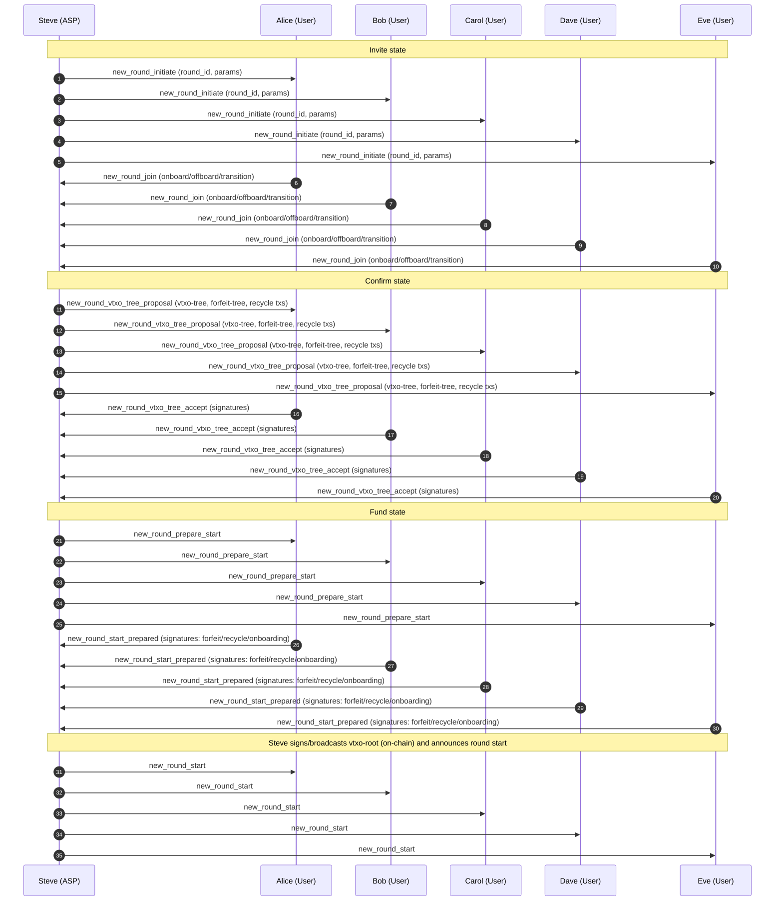

# Example 1.0

## Alice, Bob, Carol, Dave, and Eve create a VTXO tree

In this part of the example, the users join a new ARK round run by Steve.

1. Steve issues a `new_round_initiate`
    1. Informs everybody that a new round is starting.
2. Alice, Bob, Carol, Dave, and Eve reply with `new_round_join`
    1. Here the Users declare what to onboard, what to offboard, and what to transition.

3. Steve issues a `new_round_vtxo_tree_proposal`
    1. Here Steve sends out the VTXO tree for signing.
4. Alice, Bob, Carol, Dave, and Eve issue a `new_round_vtxo_tree_accept`
    1. Here the Users return the signed nodes.

5. Steve issues a `new_round_prepare_start`
    1. Here Steve sends out the new root for signature, binding the tree to the root.
6. Alice, Bob, Carol, Dave, and Eve issue a `new_round_start_prepared`.
    1. Here all Users accept the tree.

7. Steve issues a `new_round_start`.
    1. The root is deposited and the round starts. This is the official start of the round.
